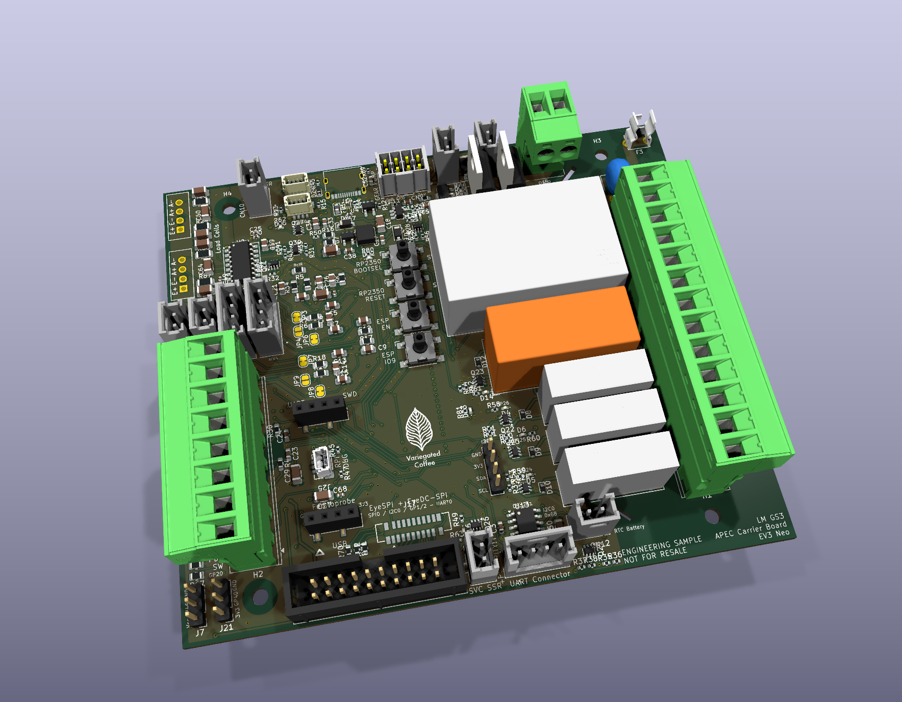

# APEC Carrier Board for the La Marzocco GS3

*APEC carrier board EV3, rendered in KiCad without the APEC SoM fitted.*

Espresso electronics are usually proprietary affairs with little to no expandability. The purpose of this project is to give everyone an open source alternative with lots of features and flexibility.

This board is a carrier for the [APEC SoM](https://github.com/variegated-coffee/apec-som), the All Purpose Espresso Controller System-on-Module. It replaces the control board of a La Marzocco GS3: it fits the machine's mains, sensor and actuator wiring, and the SoM does the rest. The SoM provides the RP2350B microcontroller, the ESP32-C6 radio, the ADS124S08 ADC, the FDC1004 capacitance-to-digital converter and a USB hub.

This project isn't affiliated with or endorsed by La Marzocco. "La Marzocco" and "GS3" are used only to say which machine the board is designed for.

## High-level features

* Mains side, on a 13-position terminal block (J2):
  * Three mechanical relays for the group, fill and tea solenoids (U9–U11, Panasonic ALDP112)
  * A 16 A relay for the stock rotary pump (K1)
  * On-board fuse (5×20 mm, clips F2/F3) and varistors on every switched output
  * On-board 12 V, 10 W AC/DC module (U5) for the low-voltage side
* Two SSR control outputs for the brew and service boilers (CN10, CN11)
* Isolated 24 V section, fed from an external 24 V supply (J5):
  * Two low-side switched 24 V outputs for proportional solenoids (CN13, CN14), driven through an ADuM3221 isolated gate driver
  * A gear pump connector (CN9) with 5 V speed, direction and tacho signals, made for the FG304
* Sensors:
  * Two RTD inputs (PT1000, ratiometric, on the SoM's ADS124S08)
  * Two pressure transducer inputs (0.5–4.5 V, 5 V supply)
  * Two load cell inputs on an NAU7802 24-bit ADC, with their own ground
  * Two capacitive level inputs (tank and boiler) on the SoM's FDC1004
  * Flow meter, paddle switch and potentiometer inputs
* Display and expansion:
  * EyeSPI connectors for a display module (J13 2×10 header and J17 18-pin FFC)
  * Two Qwiic connectors, a 4-pin I2C header, and a DS3231 RTC with a battery connector
  * microSD card slot
  * UART connector, pin compatible with the LM IoT module (J6)
* USB-C for programming and debugging. The board runs from USB alone for bench work.
* SWD header and a Femtoprobe footprint for the RP2350, and buttons for the RP2350's BOOTSEL and reset and the ESP32-C6's reset and boot mode
* Status LEDs for every output and power rail

[ENGINEERING-NOTES.md](ENGINEERING-NOTES.md) has the details, [IO.md](IO.md) the GPIO assignments, and [MANUFACTURING-NOTES.md](MANUFACTURING-NOTES.md) how to build one.

## Project status

The current revision is EV3. It hasn't been manufactured yet; EV2 is the most recent revision that has been built. [CHANGELOG.md](CHANGELOG.md) lists what changed between revisions, and [FW_NEXT.md](FW_NEXT.md) lists the firmware changes EV3 needs.

The firmware is developed separately.

## ⚠️ Safety warning

This board switches mains voltage. It is intended to be installed inside an espresso machine, which also uses high-pressure hot water and steam. Mistakes in designing, building, wiring, or programming the board or the machine can cause electric shock, fire, burns, or scalding.

Mains voltage is present on the board whenever the machine is plugged in, including on the neutral side, which can carry line voltage with an unpolarised plug. Never work on the board or handle it while it's connected to mains. Never power it from mains outside a closed, earthed enclosure.

This board is not a safety component. Safety-critical protections, such as thermal cutouts, pressure relief and the machine's own fuses, must be kept and must work independently of this board and its firmware. Only build or use it if you are competent with mains electrical work and pressurised systems, and follow local electrical regulations.

## Notice

This repository contains design files only. It is not a finished product, and it has not been tested or certified for compliance with any regulation, including but not limited to CE, UKCA or FCC requirements.

Anyone who manufactures, assembles, or places a product based on these files on the market does so as the manufacturer of that product, and is solely responsible for its safety, conformity assessment, marking, documentation, and any legal obligations that follow. If you build or use it yourself, you do so at your own risk.

The APEC SoM includes a 2.4 GHz radio transceiver (ESP32-C6). Products using it are subject to radio equipment regulations in addition to other applicable requirements.

The designs are provided “as is” under the CERN-OHL-P v2. See sections 5.1 and 5.2 for the disclaimer of warranty and limitation of liability.

## Opening the design

The project is made with KiCad 10. Every library the design needs is either in this repository or a KiCad standard library, so it opens without extra setup. A few parts exist only as copies embedded in the schematic and PCB, because their library files can't be redistributed. KiCad reports their libraries as missing, which is expected. See [THIRD_PARTY.md](THIRD_PARTY.md).

Vendor 3D models aren't included either. [3d-models/README.md](3d-models/README.md) lists where to download them for complete 3D views.

## License

The design files and documentation in this repository are licensed under the CERN Open Hardware Licence Version 2 – Permissive (CERN-OHL-P-2.0); see [LICENSE.txt](LICENSE.txt).

Some library files come from third parties and keep their own licences; see [THIRD_PARTY.md](THIRD_PARTY.md).
