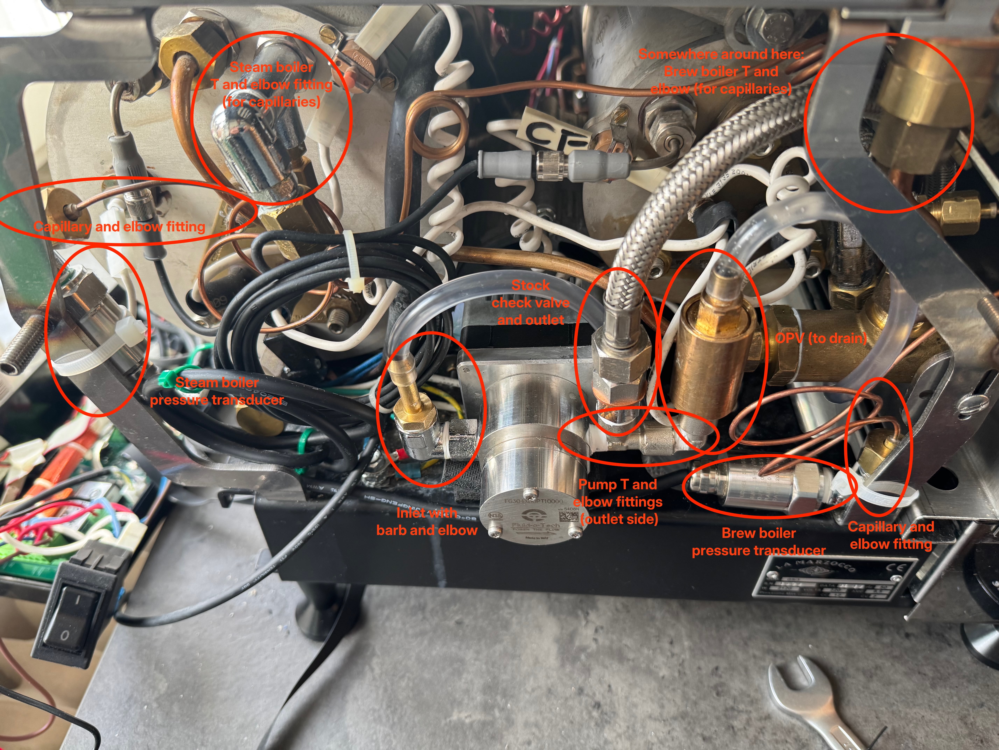
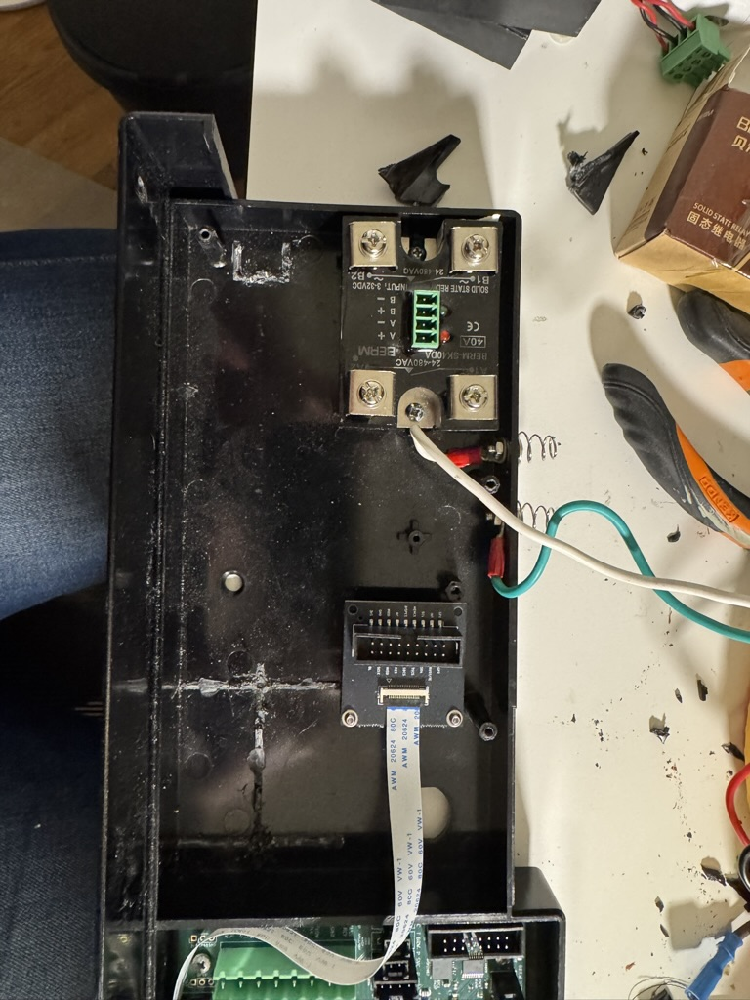
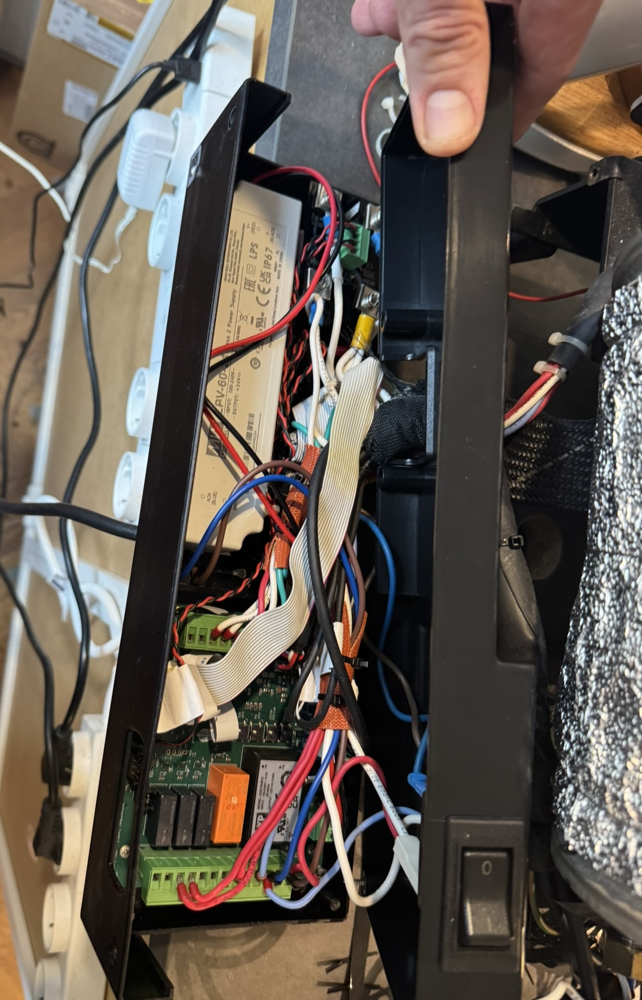

# Installing the APEC carrier in a La Marzocco GS3

> [!CAUTION]
> **This work can kill.** The carrier switches mains voltage, and the GS3 has boilers full of scalding water and steam under pressure. A mistake can electrocute someone, start a fire, or cause severe burns and scalding. The victim may be the person doing the installation, or anyone who uses the machine afterwards, long after the work is finished.
>
> **Don't attempt this without real experience of working on mains-powered electronics.** That means already knowing, without having to look it up:
>
> * how to make equipment safe to work on, and how to prove it's dead before touching it
> * how to terminate, route and secure mains wiring so that it stays safe for years in a hot, damp, vibrating machine
> * how to check that every earth connection is intact
> * how to test mains-powered equipment safely, with GFCI (RCD) protection and an isolation transformer, and without touching anything live
> * which electrical regulations apply where the machine will be used
>
> If any of that is unfamiliar, stop here. An espresso machine is not the place to learn mains work. If the machine is going to be modified anyway, have a qualified electrician do the mains work, or at the very least inspect it before the machine is plugged in.
>
> This guide is based on a single installation. It can't cover every machine, every revision or every possible mistake, and following it doesn't make an installation safe. Whoever does the work is responsible for it, and for the machine afterwards. Read the safety warning and the notice in [README.md](../README.md) as well.

> [!IMPORTANT]
> **The plumbing takes skills of its own.** Both options mean working on pressurised fittings. The pressure transducers connect to the boilers, which hold hot water and steam, and the gear pump's fittings carry cold water at up to 10 bar. Without previous plumbing experience, learn and practise the basics first, somewhere a mistake doesn't matter. That means making leak-free threaded joints, choosing the right seals and fitting materials, including metals that won't corrode galvanically where they meet, and fitting capillaries and hoses. A leak in an espresso machine isn't just a mess. Hot water and steam scald, and even a slowly dripping joint can reach the wiring or the electronics, cause a short circuit and start a fire.

How to install the APEC carrier, revision R1A, in a La Marzocco GS3, along with the optional HMI module, pressure transducers and gear pump. Check each step against the machine at hand. Pinouts and configuration are in [ENGINEERING-NOTES.md](../ENGINEERING-NOTES.md), and building the board is covered in [MANUFACTURING-NOTES.md](../MANUFACTURING-NOTES.md).

## 1. Safety rules

These rules apply throughout the installation, and every time the machine is opened afterwards.

### Mains

* **Unplug the machine before opening it, every time.** Switching it off isn't enough. Check the plug in person; never rely on someone else having unplugged it.
* **Treat every mains conductor as live, including neutral.** With an unpolarised plug, N can carry line voltage.
* **Never work on the machine, or reach into it, while it's plugged in.** To observe it while it runs, use the HMI module or USB. To change anything, unplug it first.
* **Always plug the machine into a GFCI-protected outlet** (called an RCD outside North America), both while testing and afterwards.
* **Keep every earth connection.** Reconnect every earth wire that was removed. Before plugging in, check with a multimeter that the plug's earth pin has continuity to the machine's frame and boilers.
* **Use proper mains wiring practice:**
  * Use wire rated for the voltage, current and temperature.
  * Put ferrules on stranded wire in screw terminals, with a twin ferrule where two wires share a terminal.
  * Give every cable strain relief.
  * Keep wires away from hot surfaces and sharp edges, and keep mains and low-voltage wiring apart.
* **Never fit a larger fuse** than the [fuse table](../ENGINEERING-NOTES.md#fuse) gives, and never bypass a fuse.
* **Never test on mains alone.** Have someone nearby who knows how to cut the power.

### Heat, pressure and water

* **Let the machine cool down completely before working on it.** The boilers stay hot for hours after it's switched off.
* **Only open a fitting when the boiler is cold and not under pressure**, and expect water to come out.
* **Use fittings and capillaries rated for the pressure and temperature where they're fitted**, and check every new fitting for leaks. Even a slow drip onto the wiring or into the electronics box can cause a short circuit and start a fire, and it's a shock hazard.
* **Keep the machine's own safety devices in place and working:** the safety thermostats, the boilers' pressure relief valves and the machine's fuses. The carrier and its firmware are not safety components. A firmware bug must never be the only thing standing between a boiler and overheating.

### General

* **Photograph the stock wiring and plumbing before taking anything apart**, and keep the stock control board, so the machine can be returned to stock. Label cables to help your future self.
* **Test as much as possible outside the machine**, including the mains side if possible. A fault found on the bench is one that doesn't have to be tracked down inside a cramped machine with mains wiring nearby. An issue found at the bench is also far less likely to cause other issues. When testing the mains side on the bench, preferably power it through an isolation transformer. See [Bench testing](#4-bench-testing).
* **Don't leave the machine unattended** while testing, or until it has run reliably for a while. If it smokes, smells hot, trips the GFCI or does anything unexpected, unplug it before doing anything else.

## 2. Choosing a build

Every build needs an APEC carrier, an [APEC SoM](https://github.com/variegated-coffee/apec-som) and either an HMI module or I2C adapters for the display/keyboard. The rest is optional. Most options mean buying parts and modifying the machine, so decide on them before ordering anything.

| Option | Status | What it does |
| ------ | ------ | ------------ |
| HMI module | Required for now | Replaces the stock display and keypad. The carrier has no connectors for the stock ones. I2C adapters for them are planned but not designed yet, so until they exist, the HMI module is the only option. |
| Pressure transducers | Optional | Brew and steam boiler pressure readings |
| Gear pump | Optional | Replaces the stock rotary pump with a speed-controlled Fluid-o-Tech FG304 |
| Load cells | Not covered yet | See [Not covered yet](#10-not-covered-yet) |
| (Proportional) solenoid for steam | Not covered yet | See [Not covered yet](#10-not-covered-yet) |

Sections 5 to 7 cover the options. Skip the ones the build doesn't use.

## 3. Parts and tools

### Every build

* APEC carrier R1A, assembled as described in [MANUFACTURING-NOTES.md](../MANUFACTURING-NOTES.md). Some connectors aren't fitted at assembly. CN10 and CN11 (boiler SSRs) are needed on every build; fit the connectors for the chosen options as well.
* APEC SoM
* A 2.4 GHz antenna with a U.FL connector, and a cable long enough to reach the outside of the electronics box. The SoM's ESP32-C6 module (MINI-1U) has a U.FL connector and no antenna of its own.
* TE Connectivity AMPMODU Mod II receptacle housings and crimp contacts, for new or re-terminated cables to the board's sensor and output headers
* A 5×20 mm time-lag (T), ceramic, 250 VAC fuse, rated for the build: see the [fuse table](../ENGINEERING-NOTES.md#fuse)
* Heat-resistant insulation tubing, for cables that run near the boilers
* Optional: a Qwiic cable, so I2C devices can be added later without opening the electronics box

### HMI module

* An [APEC LM GS3 HMI Module](https://github.com/variegated-coffee/apec-lm-gs3-hmi-module) and its 3D-printed bracket
* 20-way ribbon cable, 1.27 mm pitch, rated for high temperatures and long enough to run from the display to the electronics box
* Two 2×10 IDC sockets (2.54 mm pitch), one for each end of the cable
* Double-sided tape, to mount the display

### Pressure transducers

* Two 0.5–4.5 V ratiometric pressure transducers with a 5 V supply, one for each boiler. Tested with the [Xidibei XDB401 Pro](https://www.xidibei.com/en-se/collections/pressure-transducers/products/xdb401-pro-coffee-machine-ss316l-pressure-transducers) in SS316L: 0–1.6 MPa for the brew boiler and 0–0.4 MPa for the steam boiler. The thread is likely G1/8 (but depends on the capillary chosen).
* For each transducer, a capillary tube, a T fitting so the transducer can share the manometer's port, and an L (elbow) fitting
* Seals, adapters, thread sealant and other plumbing accessories to suit

Pick materials that suit the boilers and the hot, pressurised water in them. Beware of galvanic corrosion: where two different metals meet in water, one of them can corrode until the joint leaks. Check that the metals in every joint are compatible.

Some threaded joints may need a thread sealant, such as PTFE tape or a liquid sealant. Use one rated for drinking water at the joint's temperature and pressure, and keep it out of the water path: a stray shred of tape can block a capillary or stop a valve from sealing.

### Gear pump

* A Fluid-o-Tech FG304 gear pump (or another, compatible gear pump)
* Recommended: A bracket for the pump, with vibration damping. There's no ready-made bracket yet, so you'd have to make one yourself; CAD files may be published later for a nicer one.
* An over-pressure valve (OPV) that can be set to open at 10 bar. **The OPV is not optional: it's a safety component.**
* Fittings: a new barb fitting for the pump inlet, T and L fittings for the pump outlet, and a fitting and nut to mount the OPV through the front fascia
* A 24 V power supply. Tested with a Mean-Well LPV-60-24. Don't skimp on the PSU, always use a name-brand component.
* A dual SSR to replace the two stock boiler SSRs, which makes room for the 24 V supply in the electronics box. Use one at least comparable to a Sensata Crydom CC2450W2V: cheap unbranded dual SSRs are available, but aren't recommended. Remember that SSRs tend to fail closed. Its control inputs must accept the board's SSR drive voltage, VIN (about 12 V).
* A Samtec IPL1-104 header for CN9 on the board, and the matching Samtec cable housing and crimp contacts for the pump cable
* Wire for a longer pump cable, if needed: the FG304 tends to come with a short cable. Inside the pump, the cable plugs into a TE Connectivity CT connector, 2.00 mm pitch.

As with the pressure transducers, check that the metals in every joint are compatible, to avoid galvanic corrosion, and use a suitable thread sealant where a joint needs one. Keep sealant out of the OPV in particular.

### Tools

* Crimp tools for the AMPMODU Mod II and Samtec contacts, and for ferrules
* A multimeter
* A drill, for the electronics box (USB access) and, with the gear pump, the front fascia (OPV)
* Flush cutters, dremel (if installing a 24V PSU)
* Zip ties

## 4. Bench testing

Test everything that can be tested before it goes into the machine.

1. **Assemble the boards** as described in [MANUFACTURING-NOTES.md](../MANUFACTURING-NOTES.md). Double-check the polarity of every polarised part and connector.
2. **Bring up the carrier and flash the firmware** on USB power, following the [bring-up steps](../MANUFACTURING-NOTES.md#bring-up). The firmware is [variegated-rs](https://github.com/variegated-coffee/variegated-rs).
3. **Make the EyeDC-SPI cable**, the ribbon cable between J13 and the HMI module. Before plugging it in, check with a multimeter that ground is continuous from end to end. If it isn't, an IDC socket is probably the wrong way round. J13 carries VIN (about 12 V) on pin 19 and +5V on pin 20, so a reversed socket or reversed ribbon cable connectors puts those supplies on the wrong pins.
4. **Test the controller and the HMI module together**, with the display and every button.
5. **Test the new sensors and actuators.** The pressure transducers should read close to zero at atmospheric pressure. The 24 V section and the gear pump can be tested from a current-limited 24 V bench supply on J5. Give the pump water: it shouldn't run dry.
6. **Test the mains side**, if possible.

   > [!WARNING]
   > Only connect the board to mains in a closed, earthed enclosure, as the safety warning in [README.md](../README.md) requires, and only from a GFCI-protected outlet. Preferably power it through an isolation transformer. Be aware of what an isolation transformer doesn't do: touching both of its output conductors still kills, and a GFCI on its input side can't detect a fault on its output side. Keep hands off while the board is connected, and unplug it before changing anything.

## 5. Installing the pressure transducers

> [!WARNING]
> These fittings are on the boilers. Only work on them when the machine is unplugged, cold and depressurised. Use fittings and capillaries rated for the boilers' pressure and temperature, and check them for leaks when the machine first heats up.



*The pressure transducers with their capillaries and fittings, and the gear pump with its OPV.*

1. At the fitting where each manometer's capillary connects to its boiler, fit a T, so the transducer and the manometer share the port.
2. Run a capillary from each T to its transducer, with L fittings where the routing needs them.
3. Mount the transducers on the machine's frame. Zip ties work.
4. Crimp AMPMODU Mod II connectors onto the transducer cables. The pinout is printed on the board: pin 1 +5 V, pin 2 signal, pin 3 ground. The firmware expects the brew boiler transducer on J19 and the steam boiler transducer on J10.
5. Route the cables to the electronics box, with insulation tubing where they pass near the boilers.

## 6. Installing the gear pump

### Removing the stock pump

Remove the stock rotary pump completely if possible. Taking out its motor means temporarily removing one of the boilers. The alternative is to remove only the pump head: the gear pump still fits, but with the motor left in place, the left-hand side of the machine can't be closed up.

If the motor stays in the machine, disconnect it from J2 and insulate its wires.

### Plumbing

Route the water like this:

```text
Tank → pump inlet → pump outlet → T fitting
                                   ├─→ stock check valve → braided hose → rest of the machine
                                   └─→ OPV → drain
```

* Mount the pump on its bracket, with vibration damping.
* Fit the new barb fitting to the pump inlet, for the hose from the tank.
* Mount the OPV hose through a hole drilled in the front fascia, held with a fitting and a nut, for a clean install. Set it to open at 10 bar.

> [!WARNING]
> **The OPV is not optional: it's a safety component.** A gear pump is a positive-displacement pump. If the water has nowhere to go, the pressure keeps rising. Never run the gear pump without a working OPV.

### Wiring

1. If the pump's cable is too short, make a longer one. It plugs into a TE Connectivity CT connector (2.00 mm pitch) inside the pump.
2. Crimp the Samtec cable housing onto the cable, for CN9. The pinout is in [ENGINEERING-NOTES.md](../ENGINEERING-NOTES.md#outputs). Keep the signal ground (pin 3) and the motor return (pin 5) separate, as the FG304 datasheet requires.
3. Route the cable to the electronics box.

### Electronics box



*The electronics box with inner walls removed and the dual SSR fitted.*



*The electronics box with the 24 V supply, the dual SSR and the carrier in place.*

1. Remove some of the electronics box's inner walls to make room for the 24 V supply.
2. Replace the two stock SSRs with the dual SSR. The cable from the SSRs to the board may need re-terminating. **CN11's polarity is reversed compared to CN10.** On CN10, pin 2 is VIN and pin 1 is switched to ground; on CN11, pin 1 is VIN and pin 2 is switched to ground. Match each SSR input's + and − to the right pins.
3. Mount the 24 V supply. Its output goes to J5: pin 2 +24 V, pin 1 return.
4. Connect the supply's mains input to the board's mains terminal block, J2: L to pin 1 (line in) and N to pin 3 or 4.

> [!WARNING]
> The SSRs' load side and the 24 V supply's input are mains wiring. Follow the [mains rules](#mains), and use a twin ferrule wherever two wires share a terminal on J2. J2 pin 1 is ahead of the board's fuse, so that fuse doesn't protect the 24 V supply.

## 7. Installing the HMI module

1. Take out the display and keypad enclosure, and remove the two stock boards from it.
2. Snap the 3D-printed bracket onto the HMI module's PCB.
3. Fasten the display with double-sided tape, and connect its FFC.
4. Transfer the buttons to the HMI module.
5. Fit the HMI module in the enclosure, and reinstall the enclosure.
6. Remove the two stock ribbon cables, and run the EyeDC-SPI cable through the same hose to the electronics box.

## 8. Installing the controller

> [!WARNING]
> This section connects the board to the machine's mains wiring. Make sure the machine is unplugged before starting, and keep it unplugged until the end of the checks in step 8.

1. Remove the stock control board from the electronics box, and keep it.
2. Mount the antenna on the outside of the electronics box, and route its cable inside.
3. Optionally, drill a hole in the electronics box for access to the USB-C connector (J14), so firmware can be updated without opening the box.
4. Connect the antenna to the SoM's U.FL connector, and mount the carrier in the electronics box.
5. Connect the cables the build uses:

   | Cable | Connector | Notes |
   | ----- | --------- | ----- |
   | EyeDC-SPI ribbon (HMI module) | J13 | |
   | Brew boiler SSR | CN10 | |
   | Service (steam) boiler SSR | CN11 | Reversed polarity compared to CN10 |
   | Brew boiler temperature probe (stock) | J8 | |
   | Steam boiler temperature probe (stock) | J11 | |
   | Gear pump | CN9 | |
   | 24 V supply | J5 | Pin 2 +24 V, pin 1 return |
   | Brew boiler pressure transducer | J19 | |
   | Steam boiler pressure transducer | J10 | |
   | Qwiic cable (optional) | J15 or J16 | Route it out through one of the small holes in the electronics box |

6. Connect the low-voltage connector (J9), and then the mains connector (J2).
7. Fit the fuse. Without the stock rotary pump, use the lower rating in the [fuse table](../ENGINEERING-NOTES.md#fuse). Never fit a larger fuse than the table gives.
8. Check all the work before closing up:
   * Every mains terminal is tight: pull on each wire to check.
   * There are no stray strands, nor any strands missing.
   * No mains wire touches a hot surface or a sharp edge, or can chafe against one.
   * Every earth wire is reconnected.
   * The plug's earth pin has continuity to the machine's frame and boilers.
   * No fitting can drip onto the electronics box or any wiring.

## 9. First power-up

1. **USB first.** With the machine still unplugged from mains, power the carrier from USB. Check that every sensor reads sensibly: the temperature probes at room temperature, the pressure transducers close to zero, and the level probes. Check the HMI module too. The 24 V section stays off on USB power.
2. **Then mains.** Only once the sensors check out and the checks in [section 8](#8-installing-the-controller) are done: close up the electronics box and the machine, and plug the machine into a GFCI-protected outlet. Test every function again: heating, the pump, the solenoids, and the pressure readings as the boilers heat up. Observe through the HMI module or USB; never reach into the machine while it's plugged in.
3. **Stay with the machine** during the first heat-up, and watch every new fitting for leaks as the boilers come up to pressure. If anything leaks, smokes, smells hot or trips the GFCI, unplug the machine before doing anything else, and let it cool down before investigating.

## 10. Not covered yet

These haven't been installed and tested yet, so this guide doesn't cover them. It will be updated once they have been.

* **Load cells**, on J12 and J18.
* **A proportional steam solenoid**, on the 24 V outputs (CN13, CN14), which need the 24 V supply. The solenoid bought for this is the La Marzocco spare part B.2.020.
* **Removing the gicleur**, for better control of the brew process.
